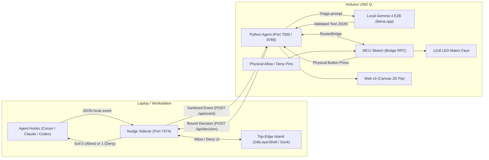

<div align="center">

# ◉ Nudge

**A desk + laptop companion for coding agents on the Arduino UNO Q.**  
*Gemma 4 runs locally on the board as the triage brain. A physical Allow/Deny button on your desk guards your machine.*

[-00979D?logo=arduino&logoColor=white)](https://applab.arduino.cc)
[-4285F4?logo=google&logoColor=white)](https://ai.google.dev/gemma)
[](https://github.com/)
[](LICENSE)
[](https://hacktoberfest.com)

<p align="center">
  
</p>

</div>

---

## What is Nudge?

When coding agents (Claude Code, Cursor, Codex, Antigravity) run in the background, you face a constant dilemma: **babysit terminal windows or tab away and stall out waiting for an approval prompt.**

**Nudge** moves your agent's permission gate from a hidden terminal tab to your physical desk:

- **Desk (Arduino UNO Q):** Meets **Pip**, a vigilant little desk creature. His 12x8 LED-matrix face reacts to your agent's state in real-time. Gemma 4 runs directly on the board's Linux MPU via the App Lab `arduino:llm` brick, triaging incoming events and keeping the gate closed until you press the **physical green Allow button**.
- **Laptop (Sidecar & Island):** A top-edge island for Linux (Wayland / X11) and a universal hook watcher. It intercepts agent actions, strips confidential environment variables, compresses commands into safe 1-liners, and binds approvals strictly to unique request IDs.

Gemma 4 is the **brain on the board**. Your laptop is the **hands with an allowlist**.

---

## Architecture



---

## Why Gemma 4 on the Board?

1. **Zero Cloud Leakage:** Cloud LLMs should not read every local terminal command or hook payload. Gemma 4 E2B runs on-board via llama.cpp. Your raw repo code, files, and secrets never touch an external server.
2. **Deterministic Tool Schema:** Gemma 4 outputs strict JSON with allowed tool definitions (`request_approval`, `notify`, `focus_session`, `open_island`). Any arbitrary shell commands or unrecognized tools are dropped by the Python validation layer.
3. **Low-Latency Desk Triage:** Instead of full-blown reasoning models, Gemma 4 is optimized as a character + triage engine: compressing 200-character commands into legible desk one-liners (*"Cursor wants `git push`"*).

---

## Pip's Moods & LED Matrix

| Mood | Expression | Behavior |
|---|---|---|
| `idle` | Gentle blinking, curved smile | Waiting for coding agent sessions. |
| `peek` | Shifted pupils, perked ears | Detects an agent session initializing. |
| `watching` | Focused wide pupils | Tracking steps (running tests, reading files). |
| `needs_you` | Pulsing alert, wide pleading eyes | **Permission requested.** LED matrix pulses, waiting for physical Allow button. |
| `happy` | Cheerful curved eyes `^^`, bouncing | Permission granted or session successfully completed! |
| `annoyed` | Flat skeptical brows `- -` | Permission denied or invalid action. |
| `dizzy` | Spinning crossed eyes `X X` | Triggered by 3+ rapid physical or virtual pokes! |
| `asleep` | Closed eyelids with floating `z Z` | Idle timeout when no sessions have run. |

---

## Quickstart (60 Seconds)

### 1. Desk: Import in Arduino App Lab
1. Download [`dist/nudge-applab.zip`](dist/nudge-applab.zip) (or build with `python3 scripts/build_applab_zip.py`).
2. Open **Arduino App Lab** on your UNO Q.
3. Click **Apps → Import Apps** and select `nudge-applab.zip`.
4. Click **Run**. Pip's Web UI will be live at `http://<board-ip>:7000`.

### 2. Laptop: Start Sidecar & Island
On your Linux laptop:
```bash
# Start the background sidecar daemon
python3 laptop/sidecar.py

# (Optional) Open the top-of-screen island
python3 laptop/island.py
```
The sidecar will display a 6-digit pairing PIN (e.g. `[ 482910 ]`).

### 3. Pair
Open Pip's Web UI at `http://localhost:7000` (or your UNO Q IP), click **Pair Laptop**, and enter the 6-digit PIN. The board and laptop exchange a cryptographic session token over your local LAN.

### 4. Run the 60-Second Demo
Want to see the full flow without configuring agent hooks?
```bash
python3 laptop/demo_session.py
```
Or click **Try 60s Demo** in Pip's Web UI. Watch Pip detect the agent, pulse when `git push` is requested, and jump with joy when you tap **Allow**!

---

## Agent Hook Setup

To link your real coding agents to Nudge, point their permission hooks to `laptop/hooks/nudge-hook`.

### Claude Code
Add to `~/.claude/settings.json`:
```json
{
  "hooks": {
    "PreToolUse": [
      {
        "matcher": "Bash",
        "command": "/absolute/path/to/nudge/laptop/hooks/nudge-hook"
      }
    ]
  }
}
```

### Cursor & Custom Agents
In your Cursor custom hook or CLI runner:
```bash
echo '{"kind":"approval","agent":"cursor","command":"npm publish","request_id":"uuid"}' | ./laptop/hooks/nudge-hook
```
*Fail-Open Guarantee:* If Nudge is not running, `nudge-hook` exits immediately with code 0 so your work is **never blocked**.

---

## Security Model

- **Request ID Binding:** Every approval request is bound to a unique `request_id`. Stale decisions or late button presses are dropped.
- **Sanitized Payloads:** The laptop sidecar strips secrets, tokens, and truncates commands to 200 characters before transmitting to the board.
- **No Remote Shell:** Gemma 4 has no execution shell tool. It can only request approvals or dispatch allowlisted UI actions (`notify`, `focus_session`, `open_island`).
- **LAN-Only Pairing:** The sidecar only listens locally. Pairing is protected by a rotating 6-digit PIN and token authentication.

---

## Repository Structure

```
├── applab/                    # Importable Arduino App Lab Package
│   ├── app.yaml              # App definition (bricks: arduino:llm, arduino:web_ui)
│   ├── python/main.py        # Python agent: Gemma 4 triage, Bridge RPC, Web UI
│   ├── sketch/               # MCU code: 12x8 LED Matrix face & button debouncing
│   │   ├── sketch.ino
│   │   └── sketch.yaml
│   └── assets/               # Web UI (Procedural Canvas 2D Pip creature, dark CSS)
│       ├── index.html
│       ├── style.css
│       └── pip.js
├── laptop/                    # Laptop Sidecar & Top-Edge Island
│   ├── sidecar.py            # Local daemon: hook sanitizer & LAN router
│   ├── island.py             # Top-edge desktop island (Wayland / X11)
│   ├── demo_session.py       # Standalone 60s demo simulator
│   └── hooks/
│       └── nudge-hook        # CLI hook script for Claude Code / Cursor / Codex
├── scripts/
│   └── build_applab_zip.py   # Packaging script generating dist/nudge-applab.zip
├── dist/                      # Packaged release archives
│   ├── nudge-applab.zip
│   └── nudge-applab.zip.sha256
├── protocol.md               # Wire protocol specifications
├── DEMO.md                   # 60-second judge demo script
├── DEV_POST.md               # DEV Community Hacktoberfest submission article
├── LICENSE                   # MIT License
└── README.md
```

---

## Credits & Inspiration

- **Concept Inspiration:** Inspired by [Coucou](https://github.com/Louis-CFM/coucou) by Louis Raillé. Nudge is a clean-room, original implementation built specifically for physical Arduino hardware, local Gemma 4 inference, and the Arduino App Lab ecosystem.
- **Character:** **Pip** is an original procedural Canvas 2D character created for Nudge.
- **Author:** Built for Hacktoberfest 2026 (Week 2: Side Hustle).

---

## License

MIT © 2026 Nudge Contributors. See [LICENSE](LICENSE) for details.
