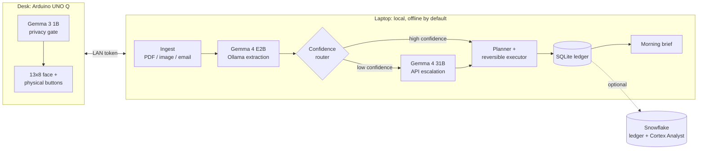

# Hacktoberfest 2026 Strategy: What Changed, What Wins, and What to Build

**Status:** Research complete — decision pending  
**Date:** 2026-10-20  
**Repo:** `Adams-404/nudge`  
**Author:** Research compiled for the Nudge project

---

## TL;DR

Three findings change the plan before we discuss ideas:

1. **Hacktoberfest 2026 has no PR count.** Pull requests no longer earn anything. You build a **brand-new project with open-source AI at its core** and write about it on DEV.
2. **Week 3 “Slow and Steady” is live now** — October 19 → **October 25, 11:59 PM PDT** (October 26, 06:59 UTC). Each submission must be a **new project started inside that window**. Nudge’s first commit is **2026-10-13**, before the Week 3 window opened, so Nudge itself is **not eligible** for Week 3. A new repo/project is required.
3. **Snowflake is not an online Week 3 prize category.** Snowflake is a Hacktoberfest sponsor, but its challenge is an **in-person Hack Day track** (“Best Open-Source AI Project with Snowflake”: use CoCo + a freely accessible dataset + open AI). For the online Week 3 challenge, the featured categories to target are **Gemma ($200)** and **Arduino ($200)**.

**Recommendation:** Build **Bottom Drawer** — a local-first, sloth-paced paperwork agent that reads the pile you’ve been avoiding overnight, finds expirations, renewals, duplicates, and money leaks, drafts the follow-ups, and asks for a physical button press before acting. Target the **Gemma** and **Arduino** categories. Treat Snowflake as an optional governed ledger, not a checkbox.

---

## 1. What I Verified

| Fact | Detail |
|---|---|
| **Hacktoberfest 2026 organizers** | MLH + DEV, presented by DigitalOcean. Theme: “AI belongs to everyone.” |
| **What counts** | Virtual stickers from Fests, livestreams, DEV Challenges, Global Hack Week, tools, and surveys. **Pull requests no longer count.** No PR target. The `hacktoberfest` repo topic and `hacktoberfest-accepted` label earn nothing in 2026. |
| **Rewards** | 3 stickers = real sticker pack; 10 = bonus holographic sticker; 15 = Completionist raffle (t-shirt or Arduino UNO Q). Sign-in + mailing address are required first. |
| **Week 3 dates** | October 19 → October 25, 2026, 11:59 PM PDT (October 26, 06:59 UTC). Winners announced the week of October 26. |
| **Week 3 theme** | **Slow and Steady** — “build something with open-weight models or open-source AI that rewards laziness: a tool for relaxation, an automation for a task you dread, or anything that makes life easier.” |
| **Week 3 prizes** | Overall winner: $250 + DEV++ + exclusive badge. Six featured categories: $200 each + badge. Fourteen partner categories: $100 each + badge. |
| **Week 3 featured categories** | Best Use of Render, TabPFN, Tinker, **Arduino**, DigitalOcean, **Gemma**. |
| **Week 3 partner categories** | Auth0 for AI Agents, Backboard, Browserbase, ElevenLabs, Entire, GitHub Copilot, Mastra, MongoDB Atlas, Sentry Agent Tracing, SerpApi, Temporal, Tiger Data, Ultramarine (Paper Instruments), .tech Domain. |
| **Snowflake in Week 3** | **Not listed.** Snowflake is a Hacktoberfest sponsor, but it is not one of the 20 online Week 3 prize categories. |
| **Judging criteria** | Writing quality (**weighted most heavily**), relevance to prompt/theme, creativity, technical execution, use of partner technology (optional). |
| **New-work rule** | “All submissions and their respective repositories must be started and completed within the challenge window.” Prior open-source work can be reused only if your changes are significant and clearly credited. |
| **Teams** | Up to four people; one submission per team; list all DEV handles in the post. |
| **Eligibility** | 18+, DEV Member, not in an excluded jurisdiction, no entry fee. |
| **AI disclosure** | DEV requires accurate disclosure for AI-assisted writing (`some_ai` for human-authored with meaningful AI assistance; `fully_autonomous` only for agent-produced text). The human author must verify facts and be able to stand by the post. |

### Current Gemma and hardware facts

| Fact | Detail |
|---|---|
| **Gemma 4 is current** | Released March 31, 2026 in E2B, E4B, 31B, and 26B A4B sizes; Gemma 4 12B Unified released June 3, 2026. |
| **Local Gemma** | Ollama provides `gemma4:e2b` (4.6–7.5 GB, 128K context, text + image), `gemma4:e4b`, `gemma4:12b`, `gemma4:26b`, `gemma4:31b`. |
| **Gemma API** | Gemini API serves `gemma-4-31b-it` with a **free tier** for input and output tokens (rate-limited). Good for low-volume escalation and final writing. |
| **Arduino UNO Q** | 2 GB or 4 GB RAM; Qualcomm QRB2210 quad-core + STM32U585 MCU; 8×13 blue LED matrix; Wi-Fi 5 / BT 5.1; Debian Linux + Zephyr; Arduino App Lab. |
| **Board-local LLM** | App Lab’s `arduino:llm` brick currently runs **Gemma 3 1B** well (~1 GB Q4). Gemma 4 E2B QAT (~3 GB) is only realistic on the 4 GB variant, and Debian/desktop services consume 1–1.5 GB. |
| **Practical split** | Board = physical UI, approval gate, and optional on-device privacy classifier (Gemma 3 1B). Laptop = bulk inference with Gemma 4 E2B via Ollama. Cloud = rare escalation with Gemma 4 31B via API. |

### Snowflake facts

| Fact | Detail |
|---|---|
| **Snowflake CoCo** | CoCo is the new name for **Cortex Code**, Snowflake’s data-native AI coding agent (web, desktop, CLI). CLI install: `curl -LsS https://ai.snowflake.com/static/cc-scripts/install.sh \| sh`, then `cortex`. |
| **Snowflake trial** | New accounts get a free trial with bundled usage (product page mentions $40 in free credits / 30 days). CoCo is billed on token consumption; compute and storage are billed separately. |
| **Cortex AI** | Cortex AI Functions (LLM functions), Cortex Agents, Cortex Analyst, Cortex Search, Cortex Fine-tuning, Cortex AI Guardrails. |
| **Free data** | `SNOWFLAKE_SAMPLE_DATA` is shared with every account and incurs no storage charges (queries need a running warehouse). Snowflake Marketplace has free listings. |
| **In-person Snowflake challenge** | “Best Open-Source AI Project with Snowflake”: use **Snowflake CoCo** to find/understand a freely accessible dataset, build an open-source AI project around it, publish a public GitHub repo with an OSS license. Prize: Arduino Tiny ML Kit (subject to regional inventory). |

---

## 2. The Three Findings in Detail

### Finding 1 — PRs no longer count

The official FAQ says it directly:

> “Pull requests and merge requests will no longer count toward Hacktoberfest rewards. It’s easier than ever to submit low-effort spam PRs to projects, so we’re listening to maintainer feedback and no longer actively incentivizing PRs.”

The replacement is a build-and-write program:

> “Instead of counting PRs, you’ll write your first skills.md, build your own open-source agent, fine-tune an open-weight model, or go wherever your curiosity takes you.”

**Implication:** “Hacktoberfest ready” now means a **great open-source AI project + a great DEV write-up**, not labels, topics, or a PR count. The repo still matters, but the story and the demo matter more.

### Finding 2 — Week 3 is live, and Nudge is not eligible

- Week 3 started **October 19, 2026**.
- Nudge’s first commit is **October 13, 2026**.
- The rules require the project and repository to be **started and completed within the challenge window**.
- A new project can reuse prior work only if the new work is **significant** and **clearly credited**.

**Implication:** create a **new repo** for the Week 3 entry. Keep Nudge as a separate open-source project and credit its hardware bridge/LED work as prior art if reused.

Also note: `DEV_POST.md` in this repo is still `published: false`, and no published Nudge post was found via the DEV API. If it was never published, the Week 2 window closed on **October 19 at 06:59 UTC**. That makes Week 3 the practical opportunity.

### Finding 3 — Snowflake is not an online Week 3 category

The Week 3 page lists 20 categories. Snowflake is not one of them. The Snowflake Hacktoberfest challenge is an **in-person Hack Day partner track** with a different recipe:

1. Use **Snowflake CoCo** to find or understand a freely accessible dataset (Marketplace or sample data).
2. Use CoCo to understand the dataset, write queries, or create a data pipeline.
3. Build an AI application, agent, analysis, or useful experience with **open-source/open-weight AI**.
4. Publish a **public GitHub repo with an open-source license**.
5. Show how CoCo helped.

**Implication:** forcing Snowflake into the online entry will not win a Snowflake prize. Use it only if it genuinely improves the product, and target **Gemma + Arduino** online.

---

## 3. Strategic Read: What Actually Wins

Week 1’s winners were **personal, specific, story-driven**, and often had a physical or unusual interaction:

- **Overall:** “Paper Trail: Gemma writes your walk a field card, then the screen goes away.”
- **Arduino:** “I Won an Arduino UNO Q at a Hack Day. Now I’m Building a Device to Help Me Touch Grass.”
- **Gemma:** “Grow a Song: my run wrote its own soundtrack, with Gemma running on my phone.”

Week 2 was crowded with freelancer tools: scope-creep guards, invoice sorters, WhatsApp order sheets, local financial auditors.

Week 3 will be crowded with:

- file/inbox tidiers
- overnight chat summarizers
- fridge-photo grocery lists
- bedtime story and ambient-sound generators
- generic “lazy” productivity apps

**To stand out, the project needs:**

1. A **fresh take on a familiar problem**, not a generic utility.
2. A **personal story** with a concrete before/after.
3. A **measurable lazy payoff** — hours saved, dollars found, deadlines caught.
4. A **memorable physical demo**.
5. **Excellent writing** — the heaviest judging criterion.
6. **Genuine open-weight use** — local inference, swappable models, privacy, zero marginal cost.

---

## 4. Recommended Idea: Bottom Drawer

**One-line pitch:**

> *A sloth named Largo lives in your bottom drawer. While you sleep, he reads the paperwork you’ve been avoiding and tells you what expires, renews, or needs a reply — before it costs you.*

**Working names:** project **Bottom Drawer**, mascot **Largo** (a sloth). Both are working names; do a final repo/trademark check before publishing.

### Why this idea

Everyone has a bottom drawer: receipts, bills, warranties, insurance letters, contracts, tickets, half-finished claims. The problem is not hard work — it’s **decision fatigue and avoidance**. That makes it emotionally relatable and a literal fit for “rewards laziness.”

It is also **not another invoice sorter**. The product is about **time-sensitive obligations and money leaks**:

- a warranty that expires in nine days
- a subscription auto-renewing in three days
- a duplicate charge
- a bill that’s due
- a contract with a notice period
- a receipt needed for a claim

The lazy payoff is concrete: **hours saved + dollars found + deadlines caught**.

### The story for the DEV post

> “I emptied my bottom drawer onto the desk: 63 documents, two years of avoidance. Largo read all of them overnight. In the morning he had filed 61, flagged a warranty expiring in nine days, found $412/year in subscriptions I’d forgotten about, and drafted four emails. I pressed one button.”

That is a winning hook: personal, specific, visual, measurable.

---

## 5. Architecture: The Three-Tier “Slow Brain”

### Tier 1 — Edge: Arduino UNO Q + Gemma 3 1B

The board answers one question: **“Is this document sensitive?”** Passport, medical, bank, ID. If yes, the document never goes to the cloud. The board also owns:

- the **Show me / Snooze / Undo** physical buttons
- the sleeping/waking sloth face on the 8×13 LED matrix
- an optional countdown to the next renewal or expiry

This gives the Arduino a real job — not just a cute display. It is the **privacy firewall** and the **human-in-the-loop**.

### Tier 2 — Local: laptop + Gemma 4 E2B via Ollama

The bulk of the work:

- extract fields from PDFs and images
- classify document types
- find duplicates and deadlines
- propose a plan
- write the ledger

Free, offline, private. Use `gemma4:e2b` on a laptop; `gemma4:e4b` if there is enough RAM. Pre-extract text with `pypdf` and only use vision for scans to keep the overnight run practical.

### Tier 3 — Cloud: Gemma 4 31B via Gemini API

Only for:

- low-confidence documents
- ambiguous categorization
- the final morning brief

The router logs every escalation, so the user can see exactly when and why the cloud was used — and turn it off. This is a genuine engineering story: **a local-first agent with a calibrated escalation ladder**, not “we called an LLM.”

### The reversible ledger

Every action is journaled with an inverse operation. Largo never deletes; he archives. The physical **Undo** button reverses the last run. This is the trust mechanism that makes an agent touching personal files acceptable — and a great demo moment.

---

## 6. What the MVP Actually Does

| Capability | Detail |
|---|---|
| **Read** | PDFs, scanned images, `.eml` / `.txt`. |
| **Extract** | Document type, vendor, date, amount, currency, renewal/expiry date, account/policy number, summary, confidence. |
| **Find** | Duplicates, upcoming renewals, expiring warranties, subscriptions, missing documents. |
| **Act** | Organize into a clean folder tree, rename, archive, write a ledger, create `.ics` reminders, draft cancellation/claim/return emails. |
| **Ask** | Natural-language questions over the ledger (“When does my passport expire?”, “What renews in the next 60 days?”). |
| **Brief** | One page: 3 things Largo did, 2 that need you, 1 thing he saved you from. |
| **Undo** | One button, full run reversal. |

**Safety boundaries:** no payments, no deletions without approval, no raw documents sent to the cloud. The agent can read, extract, organize, remind, and draft — not execute financial transactions.

### MVP scope for five days

**Keep:**

- extraction schema + local Gemma 4 E2B pipeline
- duplicate/renewal/expiry detection
- folder organization + SQLite ledger
- morning brief
- confidence router + Gemma 4 31B escalation
- web UI
- Arduino face + one physical button + bridge
- undo

**Cut if time runs short:**

- email sending and calendar sync
- Snowflake sync
- on-board privacy gate
- multi-user/team mode
- extra document types
- fine-tuning

---

## 7. Demo and Metrics

### Demo script

1. **Before:** show the drawer/pile — 63 documents, two years old, mixed formats.
2. **Run:** Largo processes overnight; show a time-lapse.
3. **Morning:** 61 filed, 2 need review, $412/year in forgotten subscriptions, a warranty expiring in 9 days, two duplicate charges, four drafted emails, zero files deleted.
4. **Physical:** press **Show me** on the Arduino; Largo wakes and displays the count.
5. **Trust:** press **Undo**; the last run reverses.
6. **Cost:** show the local-vs-escalation table.

### Metrics to measure

| Metric | How to measure |
|---|---|
| **Time saved** | Time a manual baseline on 20 documents; extrapolate to the full pile. Compare with Largo’s wall-clock + human review time. |
| **Money found** | Sum forgotten subscriptions, duplicate charges, and expiring warranties. |
| **Accuracy** | Field-level accuracy against a small labeled set, local-only vs. local + escalation. |
| **Cost** | Local $0; API token counts × price (free tier if applicable). |
| **Latency** | Per document and total run. |
| **Privacy** | Percentage of documents that never left the laptop. |

**Example table for the post:**

| Metric | Local only (E2B) | Local + escalation (31B) |
|---|---|---|
| Field accuracy | 92% | 98% |
| Cost per 63 docs | $0 | $0 (free tier) / ~$0.01 paid |
| Latency | overnight | overnight + seconds |
| Docs that never left the laptop | 100% | 90% |

Use real measured numbers; the values above are placeholders.

---

## 8. Snowflake: The Honest Answer

### For the online Week 3 entry

**Snowflake is not a prize category.** Adding it will not increase the odds, and forcing it will dilute the story. Do not do it for the online submission.

### If Snowflake is still part of the product

Use the right parts:

| Snowflake piece | Use it for | Don’t use it for |
|---|---|---|
| **CoCo (Cortex Code)** | Build-time: explore a free Marketplace/sample dataset, generate SQL, create the semantic view, document the session | Runtime dependency |
| **Cortex Analyst** | Natural-language queries over the ledger via a semantic view | The core extraction model |
| **Cortex Search** | Hybrid search over extracted summaries (not raw documents) | Sending raw receipts |
| **Snowflake REST API** | App integration from Python | Replacing Gemma |
| **Free trial** | $40 credits / 30 days; CoCo billed on token consumption | Assuming it is free forever |

### For the in-person Snowflake Hack Day track

The recipe is stricter:

1. **Snowflake CoCo** to explore a freely accessible dataset.
2. **Open-source/open-weight AI** (Gemma) for the intelligence.
3. **Public GitHub repo** with an open-source license.
4. A write-up showing how CoCo helped explore the data or build the project.

A good “team/accountant mode” for Bottom Drawer: the ledger syncs to Snowflake, and Cortex Analyst answers questions over it. A free CPI or product-taxonomy dataset could enrich the spending insights (“your grocery spend is rising faster than CPI”). That is a genuine data app — but it is a **separate track**, not Week 3.

**Bottom line:** use Snowflake as an **optional governed ledger**, not a checkbox. For Week 3, target **Gemma + Arduino**.

---

## 9. What “Hacktoberfest Ready” Means Now

Since PRs do not count, “Hacktoberfest ready” is not about `hacktoberfest` topics or `good first issue` labels. It means:

1. **A great open-source AI project** that someone can run.
2. **A great write-up** that explains why open innovation matters.
3. **A demo** that proves it works.

### Repo checklist for Bottom Drawer

| Area | Add | Why |
|---|---|---|
| **README** | Hook, 60-second demo GIF/video, problem, architecture, quickstart, privacy model, benchmarks, roadmap | Judges and contributors decide in 30 seconds |
| **One-command demo** | `make demo` with a synthetic document generator | Removes setup friction |
| **Model flexibility** | Ollama (`gemma4:e2b` / `e4b`) + Gemma API + mock provider | Proves open-weight portability |
| **Contributor docs** | `CONTRIBUTING.md`, `CODE_OF_CONDUCT.md`, `SECURITY.md`, `ARCHITECTURE.md`, `ROADMAP.md` | Signals a real project |
| **CI** | ruff + pytest + markdown lint + link check + CodeQL | Technical execution |
| **Tests** | Unit + golden-file extraction tests + mocked model + optional live-model tests | Reliability |
| **Issue templates** | Bug, feature, “new document type,” “new action” | Contributor on-ramp |
| **Good first issues** | 10–15 concrete tasks (add a doc type, add a provider, add a UI view) | Community growth |
| **Packaging** | `pyproject.toml`, console script, Docker Compose (app + Ollama), `.env.example` | Runnable |
| **Docs** | `docs/privacy.md`, `docs/benchmarks.md`, `docs/hardware.md`, `docs/snowflake.md` | Depth |
| **License** | Apache-2.0 (patent grant) or MIT | Open source |
| **AI disclosure** | Disclose AI assistance in the DEV post (`some_ai`), verify every claim | DEV rules |

### Nudge-specific upgrades

If Nudge is kept as a separate open-source project:

- Support **Gemma 4 E2B via Ollama** and **Gemma 4 31B via API**, not just the board’s Gemma 3 1B.
- Add a **no-hardware simulator** so contributors can try it.
- Add CI for the sketch (`arduino-cli compile`) and the Python tests.
- Add `CONTRIBUTING`, `SECURITY`, issue templates, and 10 good-first-issues.
- Record a 60-second demo video and add it to the README.
- Add a threat model and a “why local-first” section.

Nudge is a good project; it just cannot be re-submitted to Week 3 because of the new-work rule.

---

## 10. The 5-Day Plan (October 20–25)

| Day | Build | Deliverable |
|---|---|---|
| **Tue Oct 20** | New repo, synthetic document generator, extraction schema, Ollama Gemma 4 E2B pipeline, 10-doc golden test | `bottom-drawer extract demo/` works |
| **Wed Oct 21** | Ingest → extract → dedupe → plan → act → undo; SQLite ledger; CLI | End-to-end run on 60 docs |
| **Thu Oct 22** | Web UI (FastAPI + HTMX or vanilla), morning brief, confidence router + Gemma 4 31B escalation, cost/latency logging | Demo-able UI + benchmark table |
| **Fri Oct 23** | Arduino sloth face + buttons + bridge; privacy gate (Gemma 3 1B); fallback simulator | Physical demo works |
| **Sat Oct 24** | Polish, README, architecture diagram, demo video, benchmark write-up | Repo + video |
| **Sun Oct 25** | DEV post, final edit, publish before 11:59 PM PDT | Submission |

### Commitment

If the build starts now, it is committing to **Week 3**. If the next five days cannot be committed, wait for **Week 4 (October 26–31)** and start fresh with the new theme — a project started now will not be eligible for Week 4 either.

---

## 11. Risks and Mitigations

| Risk | Likelihood | Mitigation |
|---|---|---|
| Extraction accuracy on messy documents | Medium | Start with clean synthetic PDFs; add regex fallbacks for dates/amounts; use vision only for scans; escalate low-confidence docs. |
| Local Gemma 4 E2B is slow on CPU | Medium | Pre-extract text; keep outputs short; cache results; run overnight; use `e2b` not `e4b` on modest laptops. |
| Arduino integration eats a day | Medium | Reuse Nudge’s proven `RouterBridge` + LED matrix code; test early; keep a web simulator fallback. |
| API rate limits or outages | Low | Cache; batch; fall back to local; make the cloud optional. |
| Scope creep | High | Follow the cut list; ship a tight MVP; polish the story, not the feature count. |
| New-work rule challenge | Low | New repo created inside the window; significant new code; credit Nudge’s bridge as prior art. |
| Weak DEV post | High impact | Budget 30–40% of the time for writing, diagrams, and the demo video. Writing is the heaviest criterion. |
| AI disclosure issue | Low | Disclose AI assistance; personally verify facts; rewrite in your own voice. |

---

## 12. Alternatives Considered

| Idea | Upside | Downside |
|---|---|---|
| **Slow Mail** — an inbox that holds replies for a cooling-off period, summarizes to three items, drafts in your voice | Universal pain; strong “slow” angle | Email integration is fragile; less visual demo; crowded |
| **Chore Miner** — analyzes activity logs to find repetitive tasks and generates automations | Novel, data-centric, Snowflake-friendly | Abstract demo; hard to prove in five days |
| **Nudge only** — polish it as an open-source project and write about it outside the challenge | Reuses working hardware; low risk | **Not eligible for Week 3**; no prize/sticker |
| **Bottom Drawer** | Literal theme fit; measurable payoff; physical demo; real technical story; Snowflake-compatible | Five-day scope is tight; needs disciplined cuts |

**Recommendation: Bottom Drawer.** It is personal, useful, measurable, physical, and technically interesting — and it gives a genuine reason to use **both** local Gemma and the API, plus the Arduino.

---

## 13. Decision Needed

1. **Approve Bottom Drawer** (or pick Slow Mail / Chore Miner / Nudge-only).
2. **Which UNO Q is available — 2 GB or 4 GB?** Is it available for the next five days?
3. **Keep Nudge as a separate repo**, or pivot it? Recommended: new repo (`bottom-drawer`) and credit Nudge’s bridge as prior work.
4. **Snowflake:** optional ledger, or must-have? Recommended: optional for Week 3, with a documented path for the in-person track.
5. **Start scaffolding now?** If yes, begin with the new repo structure, extraction schema, synthetic document generator, and Ollama Gemma 4 pipeline.

---

## 14. Sources

- Hacktoberfest 2026: <https://hacktoberfest.com> · <https://hacktoberfest.com/online/> · <https://hacktoberfest.com/questions/>
- Hacktoberfest 2026 DEV Challenge hub: <https://dev.to/challenges/hf26>
- Week 3 “Slow and Steady” challenge: <https://dev.to/challenges/hacktoberfest-week3-2026-10-19>
- Week 3 launch post: <https://dev.to/devteam/join-the-hacktoberfest-open-source-ai-challenge-slow-and-steady-2850-in-prizes-across-21-3iee>
- DEV Official Challenges and Hackathon Rules: <https://dev.to/page/official-hackathon-rules>
- DEV AI guidelines: <https://dev.to/guidelines-for-ai-assisted-articles-on-dev>
- Hacktoberfest Host Handbook — Snowflake module: <https://hacktoberfest-handbook.mlh.com/hack-days-partner-challenges/partner-challenge-snowflake-coco>
- MLH “Best Use of Snowflake”: <https://www.mlh.com/challenges/01a03b87-be37-01c2-7b32-5577426e0998>
- Snowflake CoCo: <https://www.snowflake.com/en/product/snowflake-coco/>
- Snowflake Cortex overview: <https://docs.snowflake.com/en/user-guide/snowflake-cortex/overview>
- Snowflake sample data: <https://docs.snowflake.com/en/user-guide/sample-data>
- Gemma releases: <https://ai.google.dev/gemma/docs/releases>
- Gemma 4 documentation: <https://gemma.ai>
- Ollama Gemma 4: <https://ollama.com/library/gemma4>
- Gemini API pricing (Gemma 4 free tier): <https://ai.google.dev/gemini-api/docs/pricing>
- Arduino UNO Q: <https://docs.arduino.cc/hardware/uno-q/> · <https://www.arduino.cc/product-uno-q>
- Arduino App Lab: <https://applab.arduino.cc>

---

*This document is a strategy note, not a submission. Verify dates, categories, and prizes on the live challenge page before publishing anything.*
